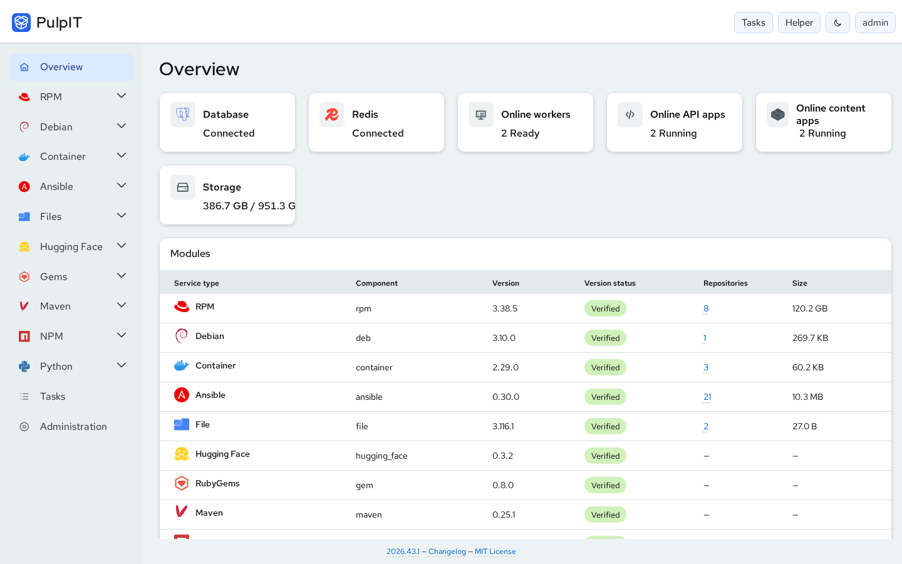
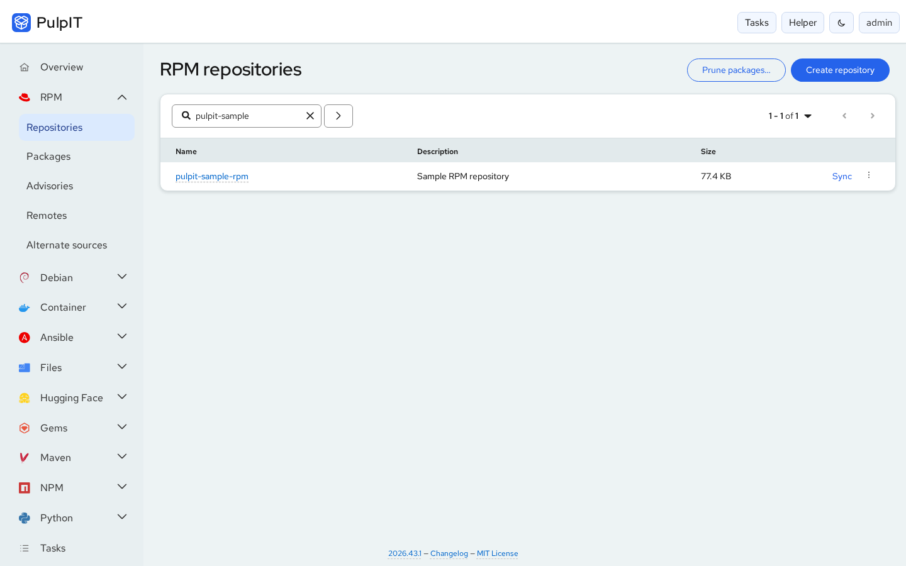
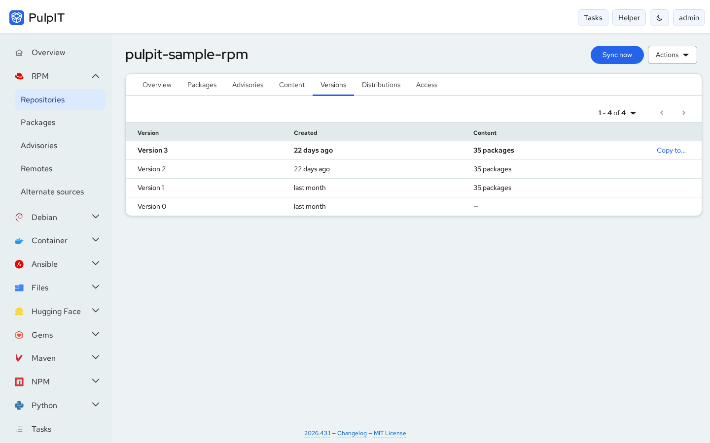
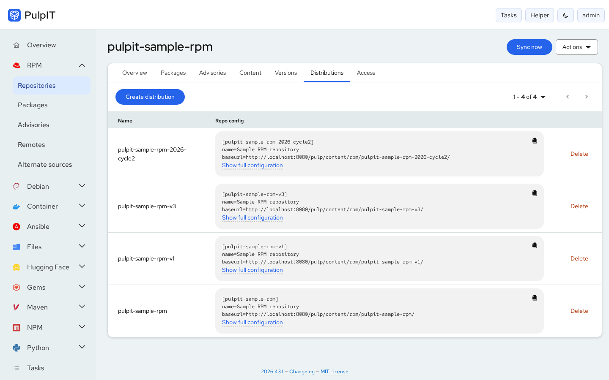
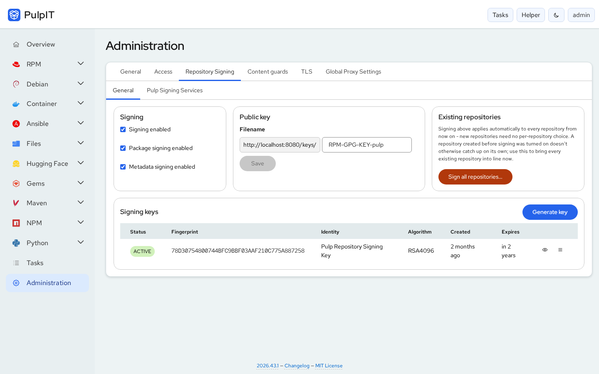

# Pulpit

A modern web interface for managing Pulp repositories, artifacts, users, and permissions through
the Pulp API.

**Website:** <https://simon-verbois.github.io/pulpit/>

[](docs/screenshots/overview.png)

<table>
  <tr>
    <td><a href="docs/screenshots/rpm-repositories.png"></a></td>
    <td><a href="docs/screenshots/rpm-versions.png"></a></td>
  </tr>
  <tr>
    <td><a href="docs/screenshots/rpm-distributions.png"></a></td>
    <td><a href="docs/screenshots/admin-signing.png"></a></td>
  </tr>
</table>

_Screenshots show a development build against a local Pulp with sample repositories (light and dark
themes are both supported). Regenerate them with `node scripts/capture-screenshots.mjs`._

## What Pulpit is

Pulp is a powerful content/repository management engine, but its default tooling isn't always the
easiest way to operate it day to day. Pulpit is a dedicated management UI for Pulp — the name is a
wordplay: Pulp is the engine, Pulpit is where you administer it from. Pulpit does not replace Pulp;
Pulp remains the entire backend and the sole source of truth. Pulpit aims to make Pulp
(pulpcore plus the RPM, Debian, container, Ansible, file, Hugging Face, RubyGems, Maven, npm and
Python plugins) significantly easier and more pleasant to
use, with a UX in the spirit of enterprise consoles like Ansible Automation Platform, Private
Automation Hub, Satellite, or the Hybrid Cloud Console — built on the open PatternFly design
system, with its own product identity (no proprietary assets, no Pulp trademarks used
misleadingly).

## Status

Pulpit is an early-stage project, but its feature sets are real and fully wired to the live Pulp
API, not mock-ups:

- **Content plugins** — RPM, Debian, Container, Ansible, Files, Hugging Face, RubyGems, Maven, npm
  and Python: repositories, sync, remotes, content browsing, version history, distributions and
  per-repository access, with each plugin's specifics (RPM advisories and alternate content
  sources, ULN remotes, container tags and manifests, Ansible collections/roles/namespaces, ...).
- **Tasks** — a masthead task drawer and a searchable task history, with plain-language failure
  explanations and retry where it makes sense.
- **Administration** — users, groups, roles and object-level grants, LDAP, repository/package
  signing key management (via `pulpit-core`), Pulp signing services, content guards, TLS
  termination, a global outbound proxy policy and default settings.

The main work still open is production deployment hardening docs (secrets management, security
headers). See [`docs/ROADMAP.md`](docs/ROADMAP.md) for exactly what's built vs. planned.

## Architecture

Pulpit's frontend is a **frontend-only** single-page application. It has no backend, database, or
auth system of its own — see [`docs/ARCHITECTURE.md`](docs/ARCHITECTURE.md) and ADR 0001. The
project also includes pulpit-core/pulpit-worker (ADR 0006), a narrowly-scoped backend for
capabilities that structurally cannot live in a browser or in Pulp's API — signing key custody and
lifecycle being the first (see [`docs/signing.md`](docs/signing.md)). Since ADR 0007, nginx +
pulpit-core + pulpit-worker are merged into one `pulpit` container/image, not three separate ones.

```
Browser -> Pulpit SPA (React + TypeScript + PatternFly) -> Pulp REST API -> PostgreSQL (owned by Pulp)
                                                          -> pulpit-core API -> pulpit-worker -> GPG
```

Pulpit and Pulp are served from one origin behind nginx (ADR 0005); the browser only ever calls
relative URLs like `/pulp/api/v3/...` and `/pulpit-core/api/...`.

## Deploying Pulpit

Pulpit ships as a single container image (nginx + pulpit-core + pulpit-worker, no Node runtime at
runtime — see [`docs/DEPLOYMENT.md`](docs/DEPLOYMENT.md) and ADR 0007) and must be deployed
alongside a Pulp instance behind one same-origin reverse proxy. Everything needed to deploy it
lives under [`deployment/`](deployment/), one subdirectory per technology, each with its own
README:

- **[`deployment/docker/`](deployment/docker/README.md)** — Docker Compose, the primary,
  most-tested reference topology.
- **[`deployment/podman/`](deployment/podman/README.md)** — plain Kubernetes-YAML manifests
  applied as Podman Quadlet (`systemd --user`) units, not a Compose wrapper.
- **[`deployment/kube/`](deployment/kube/README.md)** — plain Kubernetes manifests, no Helm.

All three run the same published `simonverbois/pulpit` image and were VERIFIED live — see
[`docs/DEPLOYMENT.md`](docs/DEPLOYMENT.md) for the deeper technical picture and what's actually
different about each.

### Prerequisites

- Docker + Docker Compose v2 (for the primary Compose path)
- A reachable Pulp instance — the bundled Compose stack runs one for you, or point Pulpit at an
  existing Pulp deployment (see [`docs/DEPLOYMENT.md`](docs/DEPLOYMENT.md))

### Estimated hardware requirements

These are **planning estimates, not benchmarks or guaranteed capacity**. They cover
Pulp, PostgreSQL, Redis, Pulpit/core and the operating system together, assuming
mostly RPM/Debian repositories, local storage, daily incremental syncs, limited
version retention and moderate client traffic. TB means decimal terabytes;
RAM uses GiB. Content means **unique retained artifacts after deduplication**,
including artifacts still referenced by older versions. Count packages/manifests,
concurrent syncs and client demand as well as repositories: 200 small repositories
can cost less than one enormous package catalog.

| Example workload                         | Concurrent syncs to start with | Host vCPU | Host RAM   | Usable local disk budget, excluding backups             |
| ---------------------------------------- | ------------------------------ | --------- | ---------- | ------------------------------------------------------- |
| Lab: 5–10 repos, 100 GB content          | 1                              | 4         | 8–16 GiB   | 250–300 GB SSD                                          |
| Small production: 50–100 repos, 1 TB     | 2                              | 8         | 32 GiB     | 1.8–2 TB SSD                                            |
| Medium production: **200 repos, 2.5 TB** | **4**                          | **16**    | **64 GiB** | **4–5 TB SSD**, preferably fast SSD/NVMe for PostgreSQL |
| Larger production: 500 repos, 10 TB      | 4–8                            | 24–32     | 96–128 GiB | 15–20 TB; separate DB and content storage               |

For **200 repositories / 2.5 TB**, a practical initial target is **16 vCPU,
64 GiB RAM and about 5 TB usable SSD capacity**. Start with four task workers,
reserve roughly 24–32 GiB for their aggregate peak memory, 12–16 GiB for the
PostgreSQL workload (including its OS cache), and leave the rest for API/content
processes, Redis, Pulpit and headroom. These allocations are starting budgets,
not measured process requirements. Package-heavy RPM repositories can exceed
ordinary worker memory assumptions; validate the largest repository first.
Pulp's [hardware guidance](https://pulpproject.org/pulpcore/docs/admin/reference/hardware-requirements/)
suggests roughly one CPU per concurrent task worker and highlights large RPM syncs
as especially memory intensive.

A storage calculation for that example is: 2.5 TB retained artifacts + 0.5 TB
expected growth + 0.2 TB provisional DB/WAL/metadata budget + 0.15 TB staging +
0.05 TB OS/logs = 3.4 TB occupied. Keeping 20% of the filesystem free requires
`3.4 / 0.8 = 4.25 TB` usable; provision approximately 5 TB. Measure the DB and
staging budget on representative repos: object count, publication count and
package metadata can change those numbers substantially. RAID/mirror overhead,
replicas, snapshots and backups require additional raw or separate capacity.
Old versions share unchanged artifacts; retention does not multiply every
repository's entire size, but it does keep superseded content alive.

Use at least 1 Gb/s networking for moderate demand; consider 10 Gb/s for parallel
client downloads or large sync windows. At a theoretical sustained 1 Gb/s,
transferring 2.5 TB alone takes about 5.6 hours, before metadata processing,
upstream limits, latency, checksums or publication. More CPU does not remove that
network floor. On-demand storage can approach the full upstream size as clients
request more content; do not size a hard disk limit assuming a fixed cache fraction.

Before purchasing or scaling, sync several representative repos including the
largest, then test the intended concurrency while clients download content.
Record peak worker RSS, database/WAL growth, storage latency, throughput, CPU
throttling and API p95 latency. Use the peak results plus growth allowance to
adjust these estimates. For sustained larger workloads, scale API, content and
workers independently with an external PostgreSQL and shared/object storage;
Pulp documents this [component scaling model](https://pulpproject.org/pulp-operator/docs/admin/guides/install/ha/).

### Memory limits (user guide)

Pulp runs as one all-in-one container: API, content serving, task workers and its
embedded PostgreSQL share a single memory limit. Large RPM syncs are the biggest
consumer. Parsing the metadata of a catalog like Oracle Linux 9 BaseOS (~20,000
packages) can take several GiB in one task. When the container exceeds its limit,
the kernel kills the sync process and the task fails with `"Killed by signal 9."`.
Pulpit then shows "Pulp worker was forcibly stopped". After you raise the limit or
lower `PULP_WORKERS`, open the failed task and choose **Retry sync**. Files that were
already downloaded are reused, not downloaded again.

**Podman** (`deployment/podman/`) ships these limits: `pulp` **8 GiB**, `pulpit`
1 GiB, `redis` 256 MiB. To change them, edit `resources.limits.memory` in
`pulp.yaml`, `pulpit.yaml` or `redis.yaml`. Set the number of concurrent syncs
with `PULP_WORKERS` in `00-configmap.yaml` (the image default is 2). Then run
`./deployment/podman/deploy.sh down` followed by `up`. Rootless Podman can only
enforce a limit when the user's systemd slice delegates the cgroup v2 `memory`
controller. Fedora and RHEL do this by default. To check, run
`cat /sys/fs/cgroup/user.slice/user-$(id -u).slice/user@$(id -u).service/cgroup.controllers`, which must list `memory`.

| Host RAM   | `pulp` limit                | `PULP_WORKERS` (concurrent syncs) | `pulpit` | `redis` |
| ---------- | --------------------------- | --------------------------------- | -------- | ------- |
| 8 GiB      | 5 GiB                       | 1                                 | 512 MiB  | 256 MiB |
| 16 GiB     | **8 GiB** (shipped default) | 1–2 (1 for large RPM repos)       | 1 GiB    | 256 MiB |
| 32 GiB     | 24 GiB                      | 2                                 | 1 GiB    | 512 MiB |
| 64 GiB     | 52 GiB                      | 4                                 | 1 GiB    | 512 MiB |
| 96–128 GiB | 80–110 GiB                  | 4–8                               | 1 GiB    | 1 GiB   |

Rules of thumb behind the table, which are estimates rather than benchmarks:

- Leave 3–4 GiB (or about 15% of the host's RAM) outside the `pulp` limit for the OS,
  its page cache and Podman.
- Inside the `pulp` limit, budget about 3 GiB for PostgreSQL, the API and content
  processes. Then budget **4–6 GiB per concurrent large RPM sync**.
- With an 8 GiB limit, run one large RPM sync at a time. Stagger their schedules,
  or set `PULP_WORKERS: "1"`.
- If a sync is still killed, raise the `pulp` limit before you raise anything
  else. Reducing download concurrency does not reduce metadata-parsing memory.

**OpenShift / Kubernetes** (`deployment/kube/`) ships no limits. Projects often
inject default limits through a `LimitRange`, which can be far too small for Pulp.
Check with `oc describe limitrange` and `oc describe quota`. Set the same value
for the memory `request` and `limit` on `pulp`. The scheduler then reserves that
memory, and the pod is not the first one evicted under node pressure. Start
from the table above, using the node's allocatable RAM as "Host RAM":

```yaml
# deployment/kube/pulp.yaml, Deployment "pulp", container "pulp"
resources:
  requests:
    memory: 8Gi
    cpu: "2"
  limits:
    memory: 8Gi
```

Or, on a running cluster:

```sh
oc set resources deployment/pulp   --requests=memory=8Gi,cpu=2 --limits=memory=8Gi
oc set resources deployment/pulpit --requests=memory=256Mi   --limits=memory=1Gi
oc set resources deployment/redis  --requests=memory=64Mi    --limits=memory=256Mi
```

Set `PULP_WORKERS` in the `pulpit-config` ConfigMap, using the table above. The
project's `ResourceQuota` must allow the sum of all requests.

### Pulp performance tuning

The detailed [performance guide](docs/PERFORMANCE.md) distinguishes settings
verified in the local stack from recommendations to benchmark. Main priorities:

- Give PostgreSQL low-latency SSD/NVMe storage and preserve memory for its cache.
- Size task workers and per-remote downloads together; more concurrency can
  reduce throughput when the DB, storage or upstream proxy saturates.
- Keep routine RPM sync optimization enabled, stagger schedules, and avoid
  repeatedly publishing an unchanged repository version.
- Keep staging and local artifact storage on the same filesystem, and use Redis
  for content-serving cache. Redis does not cache every management API list.
- Retain only versions needed for rollback and use Pulp's supported orphan cleanup
  to reclaim unreferenced artifacts; version deletion alone may not free files.

The shipped Docker, Kubernetes and Podman deployments set no container CPU/RAM
caps or reservations. Storage volume capacities remain explicit. Size the host
and worker counts for your workload; removing resource caps does not increase
the configured number of workers. Restart-sensitive tuning must be deployed
between syncs.

### Quick start

```sh
git clone https://github.com/simon-verbois/pulpit.git
cd pulpit
./deployment/docker/generate-env.sh   # generates .env with fresh secrets, prints the admin password once
docker compose -f deployment/docker/compose.yml --env-file .env up -d --build
```

Open `http://localhost:8080/` and log in as `admin` with the password the script printed. (Prefer to
set values by hand instead? `cp .env.example .env` and fill in `PULP_SECRET_KEY`
(`openssl rand -hex 32`) and `PULP_ADMIN_PASSWORD` yourself — see
[`docs/DEPLOYMENT.md`](docs/DEPLOYMENT.md).)

### Configuration

All configuration is environment-driven — see [`.env.example`](.env.example) for the full,
documented list. Key points:

- Any `VITE_*` variable is compiled into the public JS bundle at build time — never put a secret
  in one.
- `PULP_SECRET_KEY` must be a real generated secret in a local, untracked `.env` — never commit a
  real value.
- `PULPIT_PUBLIC_ORIGIN` must match the public URL Pulpit is actually served on, or logins will
  work but every subsequent action (including logout) will 403 — see
  [`docs/DEPLOYMENT.md`](docs/DEPLOYMENT.md) "CSRF_TRUSTED_ORIGINS".

### Production considerations

The bundled Compose stack is the current reference topology, not a hardened production deployment.
Before exposing Pulpit beyond a trusted network, see
[`docs/SECURITY.md`](docs/SECURITY.md) and [`docs/DEPLOYMENT.md`](docs/DEPLOYMENT.md) "Production
(future work)" for what's still missing (secrets-manager-backed secrets, hardened security
headers on top of the TLS termination Pulpit already provides) and what's already true today.
Notably, the container registry
(`/v2/`) currently runs with `PULP_TOKEN_AUTH_DISABLED`, which is not safe to carry into a
production deployment — see [`docs/DEPLOYMENT.md`](docs/DEPLOYMENT.md) "Container registry
authentication".

### Developing Pulpit

For fast frontend-only iteration and the full contributor workflow (lint/typecheck/test/build,
`make help`), see [`docs/DEVELOPMENT.md`](docs/DEVELOPMENT.md).

## Primary capabilities

- RPM/YUM: repositories, packages, advisories, remotes (including ULN), alternate content sources,
  sync, publications/distributions, repository versions, package upload.
- Container/OCI: repositories, manifests/tags, remotes, sync, distributions, copyable
  `podman`/`docker` commands.
- Ansible/Galaxy: namespaces, collections, collection versions, roles, repositories, remotes,
  import/sync.
- Debian, Files, Hugging Face, RubyGems, Maven, npm and Python: repositories, content, remotes,
  sync, versions and distributions.
- Pulpcore: tasks, system status and installed modules, users/groups/roles/permissions, LDAP,
  signing services, content guards.
- Repository/package signing key management (GPG key generation, rotation, public key
  distribution, re-signing) via `pulpit-core` — see [`docs/signing.md`](docs/signing.md).
- TLS (automatic self-signed or imported certificates) and a global outbound proxy policy — see
  [`docs/tls.md`](docs/tls.md).

See [`docs/ROADMAP.md`](docs/ROADMAP.md) for current implementation status per area.

## Technology stack

React, TypeScript (strict), Vite, PatternFly, React Router, TanStack Query, `openapi-typescript`
(schema → types, ADR 0004), Vitest + React Testing Library, Playwright, ESLint, Prettier. See
[`docs/adr/`](docs/adr/) for why each was chosen, and `package.json`/`pulpit-core/pyproject.toml`
for exact pinned versions.

## Project structure

```
pulpit/
├── docs/                  # architecture, API, auth, RBAC, UX, testing, security, roadmap, ADRs,
│                          #   plus the GitHub Pages website (index.html, styles.css, screenshots/)
├── deployment/            # one subdirectory per deployment technology, one README each
│   ├── docker/            # Dockerfile, compose.yml, compose-dev.yml, nginx/, pulpit/, pulp/
│   ├── podman/            # Quadlet (systemd --user) units over `podman kube play` (not Compose, not real Kubernetes)
│   └── kube/              # plain Kubernetes manifests (no Helm)
├── e2e/                   # Playwright specs
├── scripts/api/           # OpenAPI schema fetch + type generation
├── scripts/capture-screenshots.mjs  # regenerates docs/screenshots/ (README + website)
├── pulpit-core/           # Pulpit's own backend (ADR 0006) - see docs/signing.md
│   ├── app/               # FastAPI app: core/ (jobs, events, db), adapters/pulp/, modules/signing/
│   ├── worker/            # pulpit-worker's own process entrypoint (the only one with GPG key access)
│   ├── migrations/        # Alembic
│   └── signing-scripts/   # generic GPG signing scripts pulpit-worker publishes for Pulp to run
└── src/
    ├── app/               # App shell, router, layout (masthead/nav/breadcrumbs)
    ├── api/                # client, generated types, errors, tasks (ADR 0004)
    ├── components/        # genuinely shared components (PageHeader, *State, ...)
    ├── features/          # one subtree per product area (overview, rpm, containers, ansible, ...)
    ├── hooks/, lib/       # shared hooks/utilities
    └── test/              # Vitest setup, MSW handlers
```

## Documentation

- [Project website](https://simon-verbois.github.io/pulpit/) — overview and screenshots; its
  source lives in `docs/` (see [`docs/PAGES.md`](docs/PAGES.md))
- [`docs/ARCHITECTURE.md`](docs/ARCHITECTURE.md) — system design
- [`docs/PULP_API.md`](docs/PULP_API.md) — Pulp API integration strategy
- [`docs/AUTHENTICATION.md`](docs/AUTHENTICATION.md) / [`docs/RBAC.md`](docs/RBAC.md) — auth/permissions model
- [`docs/UX.md`](docs/UX.md) — UI/UX conventions
- [`docs/TESTING.md`](docs/TESTING.md) — testing strategy
- [`docs/SECURITY.md`](docs/SECURITY.md) — security posture
- [`docs/DEVELOPMENT.md`](docs/DEVELOPMENT.md) / [`docs/DEPLOYMENT.md`](docs/DEPLOYMENT.md) — running it
- [`docs/signing.md`](docs/signing.md) — repository/package signing (pulpit-core, ADR 0006)
- [`docs/ROADMAP.md`](docs/ROADMAP.md) — milestones and current status
- [`docs/adr/`](docs/adr/) — architecture decision records

## Current limitations

- Repository/package signing key management is implemented via `pulpit-core` — see
  [`docs/signing.md`](docs/signing.md) for what it does and does not cover (e.g. no progress
  reporting for an in-flight repository re-sign job, and a job isn't restart-safe mid-batch).
- The OpenAPI type-generation pipeline (`make api-fetch` / `make api-generate`) is implemented but
  generates an unfiltered combined schema; per-plugin schema splitting is not yet verified.
- The container registry (`/v2/`) works end-to-end in this reference stack, including a real
  `podman pull` — but via `PULP_TOKEN_AUTH_DISABLED` rather than a real signing keypair, which is
  not safe to carry into a production deployment (see [`docs/DEPLOYMENT.md`](docs/DEPLOYMENT.md)
  "Container registry authentication").
- Login works against Pulp's own accounts (session-cookie auth,
  [`docs/AUTHENTICATION.md`](docs/AUTHENTICATION.md)); LDAP is configured and applied directly
  from Administration → LDAP. SSO/reverse-proxy auth remain architecturally supported but
  unconfigured and unexercised in this environment ([`docs/ROADMAP.md`](docs/ROADMAP.md)
  Milestone 6).
- TLS termination is implemented (a two-year, automatically renewed self-signed certificate by
  default, plus manual certificate import — see [`docs/tls.md`](docs/tls.md)); secrets management and hardened
  security headers are not implemented yet beyond what's documented in
  [`docs/SECURITY.md`](docs/SECURITY.md)/[`docs/DEPLOYMENT.md`](docs/DEPLOYMENT.md) as future
  work.

## Versioning

Pulpit uses calendar-based release versions, tracked in the [`VERSION`](VERSION) file at the
repository root and shown at the bottom of the app. Each container image is built from a tagged
release matching that file. See [`CHANGELOG.md`](CHANGELOG.md) for what changed in each release.

## Contributing

No formal contribution process yet — this is an early-stage project. See
[`docs/DEVELOPMENT.md`](docs/DEVELOPMENT.md) and the documentation above when making changes.

## License

[MIT](LICENSE) — Copyright (c) 2026 Simon Verbois.

## Credits

Pulpit's product mark and favicon use Lucide's generic `package-open` pictogram under the ISC
license. Technology and plugin brand marks come from [Simple Icons](https://simpleicons.org/),
whose icon data is released under CC0 1.0; the represented names and trademarks remain the
property of their respective owners. See [`THIRD_PARTY_NOTICES.md`](THIRD_PARTY_NOTICES.md) and
[`docs/UX.md`](docs/UX.md) "Product mark and iconography".
